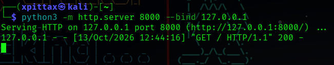
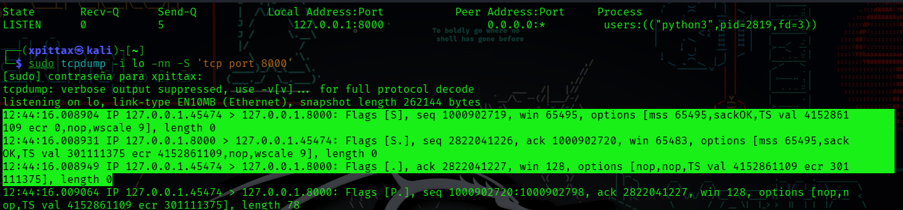
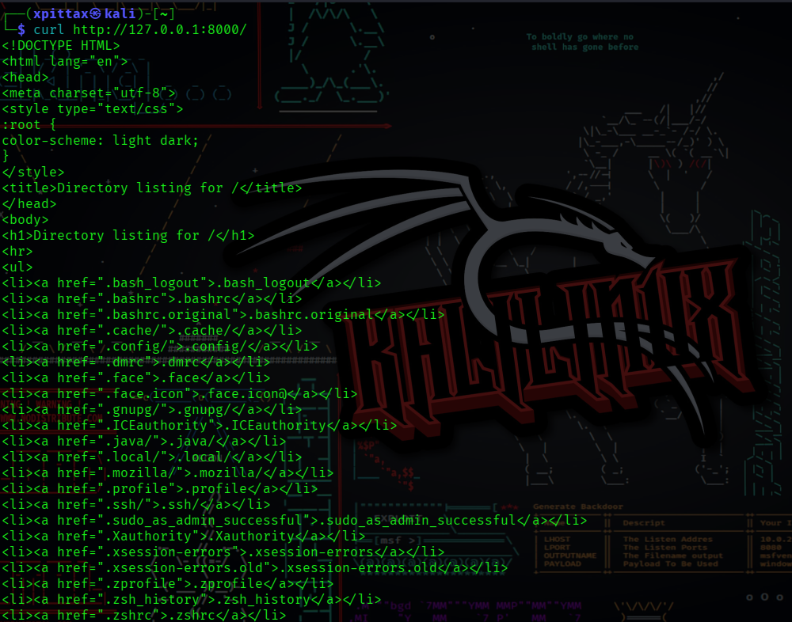

# Módulo 2: TCP, UDP y Three-Way Handshake

## 1. Objetivo

Comprender las diferencias entre TCP y UDP, estudiar el establecimiento de una conexión TCP y comprobar su funcionamiento mediante una práctica local en Kali Linux.

## 2. Conceptos aprendidos

### TCP

TCP (Transmission Control Protocol) es un protocolo de transporte orientado a conexión. Proporciona mecanismos para entregar los datos de manera fiable y ordenada, utilizando confirmaciones, números de secuencia y retransmisiones cuando corresponde.

### UDP

UDP (User Datagram Protocol) es un protocolo de transporte que envía datagramas sin establecer una conexión mediante el handshake de TCP. No garantiza por sí mismo la entrega ni el orden de los datos.

La elección entre TCP y UDP depende de las necesidades de la aplicación.

### Diferencias principales

| Característica | TCP | UDP |
|---|---|---|
| Handshake de conexión | Sí | No como el de TCP |
| Garantía de entrega | Ofrece mecanismos de entrega fiable | No la garantiza por sí mismo |
| Orden de los datos | Ofrece entrega ordenada | No la garantiza por sí mismo |
| Ejemplo de uso | Conexiones HTTP sobre TCP | DNS tradicional suele utilizar UDP |

Nota: DNS también puede utilizar TCP, y otras aplicaciones pueden emplear protocolos adicionales para proporcionar fiabilidad o cifrado.

## 3. TCP Three-Way Handshake

El establecimiento habitual de una conexión TCP se realiza en tres pasos:

1. **SYN:** el cliente solicita iniciar la conexión y envía su número de secuencia inicial.
2. **SYN-ACK:** el servidor reconoce el SYN del cliente y envía su propio SYN.
3. **ACK:** el cliente confirma la respuesta del servidor.

Una vez completado el intercambio, ambos extremos pueden comenzar a transmitir datos mediante TCP.

El handshake no cifra el tráfico ni autentica por sí mismo la identidad del servidor.

## 4. Práctica realizada en Kali Linux

### Entorno

- Sistema operativo: Kali Linux en una máquina virtual VMware.
- Servidor: `python3 -m http.server`.
- Cliente: `curl`.
- Inspección de sockets: `ss`.
- Captura de tráfico: `tcpdump`.
- Dirección utilizada: `127.0.0.1`.
- Puerto del servidor: TCP 8000.

### Procedimiento

Se inició el servidor HTTP local con:

```bash
python3 -m http.server 8000 --bind 127.0.0.1
```

Se comprobó el puerto en escucha mediante:

```bash
ss -ltnp
```

Se capturó el tráfico TCP de la interfaz loopback con:

```bash
sudo tcpdump -i lo -nn -S 'tcp port 8000'
```

Finalmente, se realizó una petición HTTP:

```bash
curl http://127.0.0.1:8000/
```

### Resultados observados

- El servidor inició correctamente.
- El puerto 8000 apareció en la salida de `ss`.
- Se identificaron los paquetes SYN, SYN-ACK y ACK en `tcpdump`.
- `curl` recibió una respuesta HTTP con un listado de archivos.

### Análisis

La captura permitió observar las tres etapas del establecimiento de una conexión TCP. La respuesta de `curl` confirmó que se recibió una respuesta HTTP del servidor local.

La dirección `127.0.0.1` corresponde a loopback, por lo que la prueba se realizó dentro de la misma máquina y no demuestra accesibilidad desde otros equipos.

## 5. Evidencias de la práctica

### Inicio del servidor




### Puerto TCP en escucha y Three-Way Handshake observado con tcpdump



### Respuesta HTTP recibida




## 6. Conclusiones

Esta práctica permitió relacionar la teoría del protocolo TCP con el tráfico observado en Kali Linux. Se identificó el Three-Way Handshake y se comprobó que el servidor local respondía a una petición HTTP.

