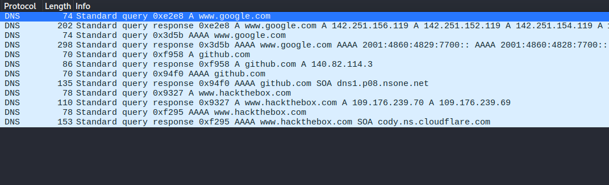
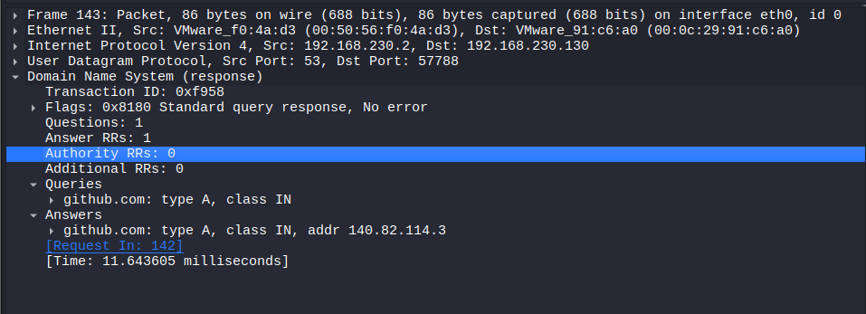
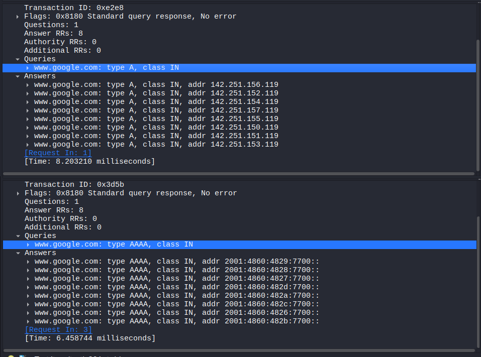
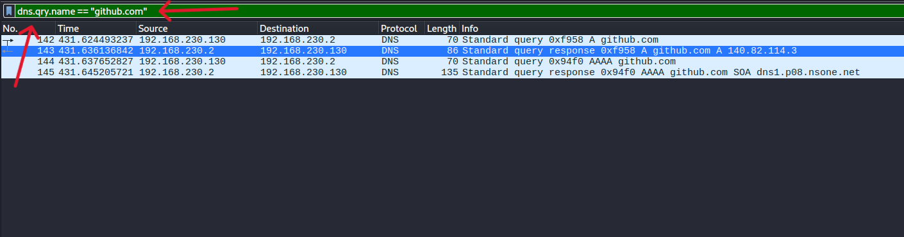

# Módulo 3 — Análisis de DNS con Wireshark

## Objetivo

Comprender el funcionamiento básico del protocolo DNS (Domain Name System), analizar consultas y respuestas DNS mediante Wireshark e identificar información relevante de red como direcciones IP, puertos, tipos de registros y Transaction ID.

También se realizó una introducción al análisis de comportamiento DNS desde una perspectiva de ciberseguridad.

---

## 1. Conceptos aprendidos

DNS permite resolver nombres de dominio en información asociada, como direcciones IP.

Los principales conceptos estudiados fueron:

- **DNS Query:** solicitud realizada para obtener información sobre un dominio.
- **DNS Response:** respuesta proporcionada por el servidor DNS.
- **DNS Server:** servidor que recibe y procesa consultas DNS.
- **Registro A:** asociado con una dirección IPv4.
- **Registro AAAA:** asociado con una dirección IPv6.
- **UDP/53:** combinación utilizada habitualmente por DNS tradicional.
- **Transaction ID:** identificador utilizado para relacionar una consulta DNS con su respuesta.

---

## 2. Entorno de laboratorio

**Sistema operativo:** Kali Linux  
**Herramienta:** Wireshark  
**Interfaz analizada:** `eth0`


La actividad se realizó dentro del entorno de laboratorio utilizando consultas DNS legítimas.

---

## 3. Captura de una consulta DNS

Se generaron consultas mediante `nslookup`, por ejemplo:

```bash
nslookup www.iana.org
```

También se realizaron consultas sobre otros dominios legítimos como:

- `www.microsoft.com`
- `www.hackthebox.com`
- `www.youtube.com`
- `www.google.com`

En Wireshark se utilizó el filtro:

```text
dns
```

Esto permitió visualizar tanto las consultas como las respuestas DNS.



---

## 4. Análisis de una consulta DNS

En una de las capturas se observó la siguiente comunicación:

```text
IP origen:      192.168.230.130
IP destino:     192.168.230.2
Puerto origen:  35577
Puerto destino: 53
Protocolo:      UDP
Dominio:        www.google.com
Tipo:           A
```

La comunicación puede representarse de la siguiente manera:

```text
192.168.230.130:35577
        |
        | UDP
        | Destination Port: 53
        v
192.168.230.2:53
```

Esto demuestra que el equipo Kali realizó una consulta DNS mediante UDP hacia el servidor DNS configurado.



---

## 5. Transaction ID

Durante el análisis se identificó el siguiente Transaction ID:

```text
Consulta:  0xa784
Respuesta: 0xa784
```

Los identificadores coincidieron entre la consulta y la respuesta.

El Transaction ID permite asociar una respuesta DNS con la consulta correspondiente.

---

## 6. Registros A y AAAA

Durante las consultas se observaron solicitudes de tipo:

```text
A
AAAA
```

### Registro A

Solicita una dirección IPv4 asociada al nombre de dominio.

```text
A → IPv4
```

### Registro AAAA

Solicita una dirección IPv6 asociada al nombre de dominio.

```text
AAAA → IPv6
```

Durante la práctica se observó que un mismo dominio podía generar consultas A y AAAA.



---

## 7. Filtros utilizados en Wireshark

Se utilizaron diferentes filtros para facilitar el análisis del tráfico.

### Mostrar tráfico DNS

```text
dns
```

### Mostrar únicamente consultas

```text
dns.flags.response == 0
```

### Mostrar únicamente respuestas

```text
dns.flags.response == 1
```

### Mostrar consultas de tipo A

```text
dns.qry.type == 1
```

### Filtrar por nombre de dominio

```text
dns.qry.name == "www.github.com"
```

El último filtro permitió visualizar únicamente los paquetes DNS relacionados con el dominio especificado.



---

## 8. Observaciones sobre el tamaño de las consultas y respuestas

Durante la captura se observó que las respuestas DNS eran generalmente mayores que las consultas.

Esto se debe a que una respuesta puede contener información adicional, como:

- Registros de respuesta.
- Direcciones IPv4 o IPv6.
- TTL.
- Información adicional de DNS.

Sin embargo, el tamaño de una respuesta no es necesariamente siempre mayor que el de una consulta; depende del contenido y del tipo de consulta.

---

## 9. Análisis desde una perspectiva de ciberseguridad

DNS también puede proporcionar información útil durante una investigación de seguridad.

Un analista puede observar:

- Qué equipo está generando consultas.
- A qué servidor DNS se están enviando.
- Qué dominios son consultados.
- Con qué frecuencia se realizan las consultas.
- Qué tipos de registros se solicitan.
- Qué direcciones IP devuelve el servidor DNS.

Por ejemplo, una gran cantidad de consultas hacia dominios con nombres aparentemente aleatorios podría justificar una investigación adicional.

Sin embargo, un dominio extraño o una consulta frecuente no demuestra por sí mismo la existencia de malware.

Es necesario recopilar evidencia adicional y establecer contexto antes de determinar si existe actividad maliciosa.

---

## 10. Conclusiones

Durante este laboratorio aprendí a analizar tráfico DNS utilizando Wireshark.

Pude identificar:

- La dirección IP del equipo que realizó las consultas.
- La dirección del servidor DNS.
- El protocolo UDP.
- El puerto 53.
- Consultas y respuestas DNS.
- Transaction ID.
- Registros A y AAAA.
- Diferentes filtros de visualización de Wireshark.

También comprendí la diferencia entre un **servidor DNS** y la **dirección IP devuelta por DNS**.

Finalmente, aprendí que el análisis DNS puede utilizarse como fuente de evidencia para detectar comportamientos potencialmente sospechosos, aunque una anomalía individual no sea suficiente para confirmar un compromiso.

---

## Alcance y seguridad

Todas las pruebas se realizaron desde mi propio entorno de laboratorio utilizando Kali Linux y consultas DNS legítimas.

No se realizaron actividades de explotación, escaneo de terceros ni interacción maliciosa con sistemas externos.

**Herramienta principal:** Wireshark  
**Entorno:** Kali Linux  
**Área:** Network Analysis / DNS / Blue Team Fundamentals
