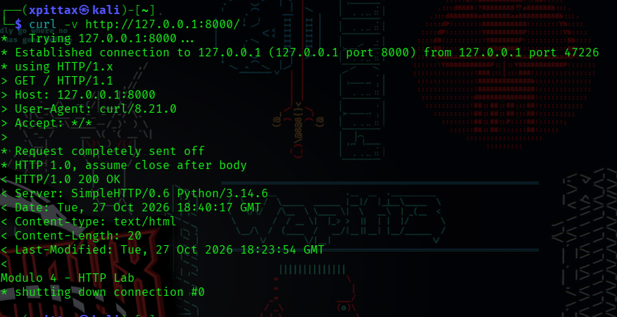

# Módulo 4: Análisis de tráfico HTTP y HTTPS

## Objetivo

Comprender el funcionamiento básico de HTTP y HTTPS, identificar solicitudes y respuestas HTTP mediante Wireshark y reconocer los elementos principales del establecimiento de una conexión TLS.

## Entorno de laboratorio

- Sistema operativo: Kali Linux en una máquina virtual.
- Herramientas: Python HTTP Server, curl y Wireshark.
- Puerto HTTP local: 8000.
- Puerto HTTPS predeterminado: 443.
- Captura local: interfaz `lo`.
- Captura hacia un servidor externo: interfaz de red utilizada por la máquina virtual.

## Práctica 1: Servidor HTTP local

Se inició un servidor HTTP local mediante:

```bash
python3 -m http.server 8000 --bind 127.0.0.1
```

Posteriormente, se realizó una solicitud con `curl` y se capturó el tráfico mediante Wireshark.



### Resultados observados

- Método HTTP: `GET`.
- Host: `127.0.0.1:8000`.
- User-Agent: `curl/8.21.0`.
- Código de respuesta: `200 OK`.
- Paquetes HTTP identificados: una solicitud y una respuesta.

Se utilizó la interfaz `lo` porque la comunicación estaba dirigida a la dirección de loopback `127.0.0.1`. Esta interfaz permite observar tráfico interno de la máquina.

## Práctica 2: Comparación de HTTP y HTTPS

Se ejecutaron los siguientes comandos:

```bash
curl -I http://example.com
curl -I https://example.com
```

### Resultados observados

| Característica | HTTP | HTTPS |
|---|---|---|
| Estado HTTP | 200 OK | 200 OK |
| Protocolo observado por curl | HTTP/1.1 | HTTP/2 |
| Puerto predeterminado | 80 | 443 |
| Protección TLS | No | Sí |

En Wireshark, la captura HTTP permitió identificar una solicitud con el método `HEAD` y una respuesta con código `200`.

En la captura HTTPS se identificaron direcciones IP, el puerto 443, tráfico TLS y mensajes del handshake como `Client Hello` y `Server Hello`. También se observaron extensiones TLS.

## Conceptos aprendidos

- `GET` solicita un recurso al servidor.
- `HEAD` solicita los encabezados de la respuesta sin solicitar el cuerpo del recurso.
- El encabezado `Host` identifica el host solicitado.
- `User-Agent` proporciona información declarada por el cliente HTTP.
- El código `200 OK` indica que la solicitud se atendió satisfactoriamente.
- Los puertos de origen del cliente suelen ser temporales, mientras que el servidor escucha en un puerto determinado.
- HTTPS protege el contenido HTTP mediante TLS.
- El handshake TLS permite negociar los parámetros necesarios para establecer una comunicación protegida.
- Las extensiones TLS aportan información sobre las capacidades y los parámetros de negociación.

## Perspectiva de análisis SOC

Una solicitud a una ruta como `/admin` no demuestra por sí sola que exista una cuenta administrativa ni que se esté realizando un ataque. Para investigar actividad potencialmente sospechosa, se deben correlacionar las rutas solicitadas, los códigos de respuesta, la frecuencia de las solicitudes, las direcciones de origen y otros registros disponibles.

El encabezado `User-Agent` puede aportar contexto, pero puede falsificarse y no debe considerarse una prueba concluyente de la identidad del cliente.

En una captura HTTPS convencional, los encabezados HTTP y el contenido de la aplicación están cifrados durante el transporte. Sin embargo, los metadatos de red y ciertos elementos de la negociación TLS pueden seguir siendo observables.

## Evidencias

Las capturas de pantalla correspondientes a las prácticas se encuentran en la carpeta `evidence/` de este módulo.

## Conclusión

La práctica permitió identificar solicitudes y respuestas HTTP, interpretar encabezados y códigos de estado, y observar elementos del establecimiento de TLS. Estos conocimientos constituyen una base para analizar tráfico web y correlacionar eventos en investigaciones de ciberseguridad.

**Alcance:** práctica educativa realizada en un entorno local controlado y mediante solicitudes HTTP/HTTPS de prueba.

