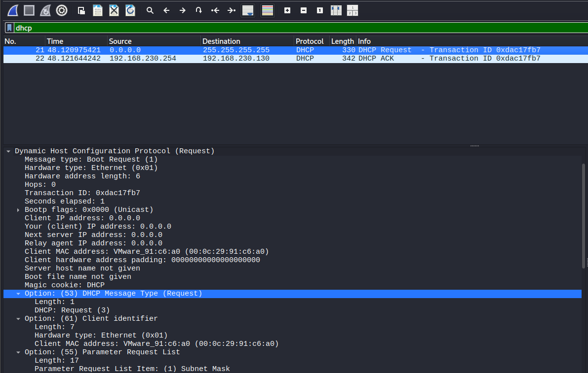
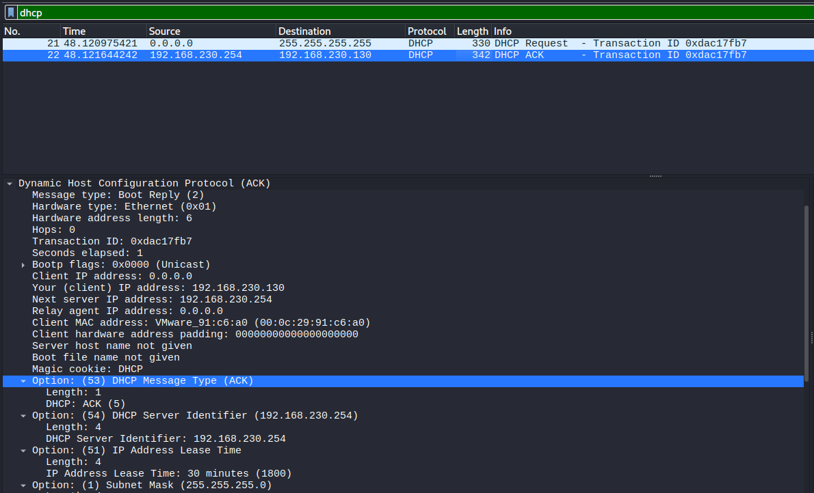
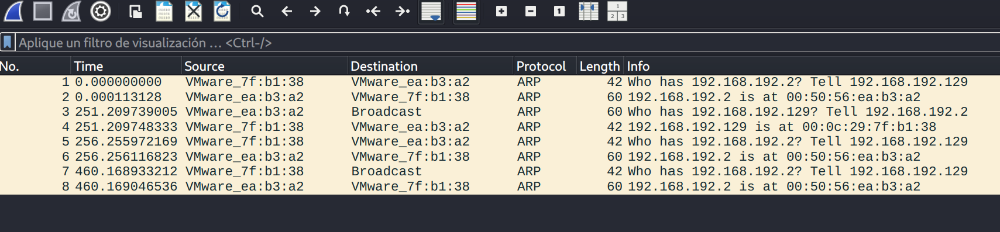
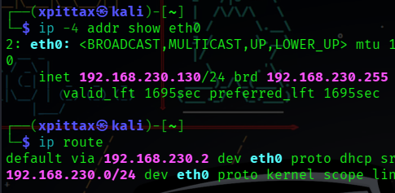

# Módulo 5 — DHCP, ARP y NAT

## 1. Descripción general

En este módulo se estudiaron tres mecanismos fundamentales de las redes informáticas: DHCP, ARP y NAT.

Se realizaron ejercicios prácticos utilizando Kali Linux, VMware y Wireshark para comprender cómo los dispositivos obtienen su configuración de red, cómo identifican a otros dispositivos dentro de una red local y cómo se comunican con redes externas mediante la traducción de direcciones IP.

## 2. Objetivos de aprendizaje

- Comprender el funcionamiento del protocolo DHCP y el proceso DORA.
- Identificar mensajes DHCP Request y ACK mediante Wireshark.
- Comprender cómo ARP relaciona direcciones IPv4 con direcciones MAC.
- Capturar y analizar paquetes ARP Request y ARP Reply.
- Comprender el funcionamiento de NAT y PAT.
- Identificar las diferencias entre direcciones IPv4 privadas y públicas.
- Reconocer posibles riesgos de seguridad relacionados con DHCP y ARP.

## 3. DHCP — Dynamic Host Configuration Protocol

DHCP es un protocolo que permite asignar automáticamente la configuración de red a los dispositivos conectados a una red.

Entre los parámetros que puede proporcionar se encuentran:

- Dirección IPv4.
- Máscara de subred.
- Puerta de enlace predeterminada.
- Servidor DNS.
- Tiempo de concesión de la dirección IP (lease).

### 3.1 Proceso DORA

Durante la asignación inicial de una dirección IP, DHCP utiliza cuatro mensajes principales:

1. **Discover:** el cliente busca un servidor DHCP disponible.
2. **Offer:** el servidor ofrece una configuración de red al cliente.
3. **Request:** el cliente solicita la configuración ofrecida.
4. **Acknowledge (ACK):** el servidor confirma la asignación de la configuración.

DHCP utiliza UDP en los siguientes puertos:

- Puerto 67: servidor DHCP.
- Puerto 68: cliente DHCP.

### 3.2 Práctica realizada

Se realizó una captura de tráfico DHCP utilizando Wireshark mientras se desconectaba y reconectaba la conexión de red de Kali Linux.




Durante la captura se identificaron los siguientes mensajes:

- DHCP Request (3).
- DHCP ACK (5).

Los mensajes fueron identificados mediante la opción DHCP 53, que indica el tipo de mensaje DHCP.

La captura mostró un intercambio Request seguido de ACK, en lugar del proceso DORA completo. Este comportamiento puede presentarse durante la renovación de una concesión DHCP, cuando el cliente solicita confirmar una configuración que ya tenía asignada.

### 3.3 Consideraciones de seguridad

Algunas amenazas relacionadas con DHCP son:

- **Rogue DHCP Server:** servidor DHCP no autorizado que proporciona configuraciones maliciosas a los dispositivos.
- **DHCP Starvation:** ataque que busca agotar las direcciones IP disponibles en un servidor DHCP mediante múltiples solicitudes.
- **Manipulación de configuración:** asignación de servidores DNS o puertas de enlace maliciosos para redirigir el tráfico de los usuarios.

Estas amenazas pueden afectar la disponibilidad de la red, redirigir comunicaciones o facilitar otros ataques.

## 4. ARP — Address Resolution Protocol

ARP es un protocolo utilizado para relacionar una dirección IPv4 con su correspondiente dirección MAC dentro de una red local.

Cuando un dispositivo conoce la dirección IPv4 de destino, pero desconoce su dirección MAC, envía una solicitud ARP mediante broadcast.

El dispositivo que posee la dirección IPv4 solicitada puede responder con un mensaje ARP Reply que contiene su dirección MAC.

### 4.1 ARP Request y ARP Reply

- **ARP Request:** solicita identificar qué dispositivo posee una dirección IPv4 determinada.
- **ARP Reply:** proporciona la dirección MAC asociada con la dirección IPv4 solicitada.

En Ethernet, una trama broadcast utiliza la siguiente dirección MAC de destino:

`ff:ff:ff:ff:ff:ff`

Cuando un dispositivo necesita comunicarse con otro que se encuentra fuera de su subred local, normalmente resuelve la dirección MAC de su puerta de enlace predeterminada, no la del servidor remoto.

### 4.2 Práctica realizada

Se inspeccionó la tabla de vecinos ARP de Kali Linux y se eliminó una entrada existente de la puerta de enlace para provocar una nueva resolución de dirección MAC.

Comandos utilizados:

```bash
ip neigh
```

```bash
sudo ip neigh del 192.168.192.2 dev eth0
```

```bash
ping -c 1 192.168.192.2
```

Posteriormente, se utilizó Wireshark para capturar y analizar los paquetes ARP.



Información observada durante la práctica:

| Parámetro | Resultado |
|---|---|
| Interfaz de red | eth0 |
| Dirección IPv4 de Kali | 192.168.192.129 |
| Puerta de enlace | 192.168.192.2 |
| Dirección MAC de la puerta de enlace | 00:50:56:ea:b3:a2 |
| Dirección MAC de Kali | 00:0c:29:7f:b1:38 |

La captura incluyó solicitudes ARP y respuestas ARP intercambiadas entre Kali Linux y la puerta de enlace.

### 4.3 Consideraciones de seguridad

El **ARP Spoofing** o **ARP Poisoning** es una técnica mediante la cual un atacante envía mensajes ARP falsificados para asociar una dirección IPv4 con una dirección MAC incorrecta.

Esto puede permitir que el atacante intercepte tráfico de red y realice ataques de tipo Man-in-the-Middle (MitM).

La presencia de asociaciones IP-MAC duplicadas o inesperadas debe investigarse. Sin embargo, también pueden existir causas legítimas, como cambios de interfaces de red, máquinas virtuales o mecanismos de alta disponibilidad.

## 5. NAT y PAT

### 5.1 NAT — Network Address Translation

NAT es un mecanismo de traducción de direcciones de red que modifica las direcciones IP de los paquetes que atraviesan un dispositivo de red.

Uno de sus usos más comunes es permitir que múltiples dispositivos con direcciones IPv4 privadas accedan a Internet compartiendo una dirección IPv4 pública.

Los rangos de direcciones IPv4 privadas son:

- `10.0.0.0/8`
- `172.16.0.0/12`
- `192.168.0.0/16`

Estas direcciones no son globalmente enrutables a través de Internet.

### 5.2 PAT — Port Address Translation

PAT amplía el funcionamiento de NAT mediante la traducción de números de puerto.

Esto permite que varios dispositivos compartan una misma dirección IPv4 pública y que sus diferentes conexiones puedan distinguirse mediante las traducciones correspondientes.

Esta técnica también se conoce como NAT Overload o NAPT y es utilizada habitualmente por los routers domésticos.

### 5.3 Práctica realizada

Se inspeccionó la configuración de red de Kali Linux mediante los siguientes comandos:

```bash
ip -4 addr show eth0
```

```bash
ip route
```



Posteriormente, se consultó la dirección IPv4 pública observada desde Internet utilizando:

```bash
curl -4 https://ifconfig.me
```


Resultados obtenidos:

| Parámetro | Resultado |
|---|---|
| Dirección IPv4 privada de Kali | 192.168.230.130/24 |
| Puerta de enlace predeterminada | 192.168.230.2 |
| Dirección IPv4 pública observada | 189.196.202.59 |

Se identificó una diferencia entre la dirección IPv4 privada de Kali Linux y la dirección IPv4 pública observada por el servicio externo.

Esto demuestra que existe traducción de direcciones en el recorrido de la conexión.

Debido a que Kali Linux se ejecutaba dentro de VMware, la red virtual puede realizar una primera traducción NAT antes de que el tráfico llegue a la red física. También puede existir una traducción adicional en el router físico o en la infraestructura del proveedor de Internet.

Los resultados obtenidos no permiten determinar por sí solos todas las etapas de traducción.

### 5.4 Consideraciones de seguridad

NAT es principalmente un mecanismo de traducción de direcciones y no debe confundirse con una solución completa de seguridad.

Por sí solo, NAT no:

- Cifra las comunicaciones.
- Detecta malware.
- Sustituye las funciones de un firewall.
- Garantiza la protección contra accesos no autorizados.

Es necesario complementar la infraestructura de red con controles de seguridad adicionales, como firewalls, monitoreo de tráfico y mecanismos de detección de amenazas.

## 6. Resultados y conocimientos adquiridos

Durante el desarrollo de este módulo se reforzaron los siguientes conocimientos:

- DHCP permite configurar automáticamente los parámetros de red de los dispositivos.
- El proceso DORA está compuesto por Discover, Offer, Request y Acknowledge.
- Durante una renovación DHCP puede observarse únicamente Request y ACK.
- ARP permite relacionar direcciones IPv4 con direcciones MAC dentro de una red local.
- ARP utiliza solicitudes broadcast cuando se desconoce la dirección MAC necesaria.
- ARP Spoofing puede facilitar la interceptación de comunicaciones mediante ataques MitM.
- NAT permite traducir direcciones IP entre diferentes redes.
- PAT utiliza la traducción de puertos para distinguir conexiones que comparten una misma dirección IP pública.
- Las direcciones IPv4 privadas y públicas cumplen funciones diferentes en la comunicación entre redes.

## 7. Conclusión

Este módulo permitió comprender y poner en práctica tres mecanismos fundamentales para el funcionamiento de las redes informáticas: DHCP, ARP y NAT.

Mediante ejercicios realizados en Kali Linux y análisis de tráfico con Wireshark, se estudiaron los procesos de asignación de direcciones IP, resolución de direcciones MAC y traducción de direcciones de red.

También se identificaron posibles riesgos de seguridad relacionados con DHCP y ARP, así como las limitaciones de NAT como mecanismo de protección.

Estos conocimientos son importantes para el análisis de tráfico de red, la identificación de comportamientos sospechosos y la investigación de incidentes de seguridad dentro de un entorno SOC.

## 8. Herramientas utilizadas

- Kali Linux.
- VMware.
- Wireshark.
- Comandos de administración de red de Linux.
- curl.

